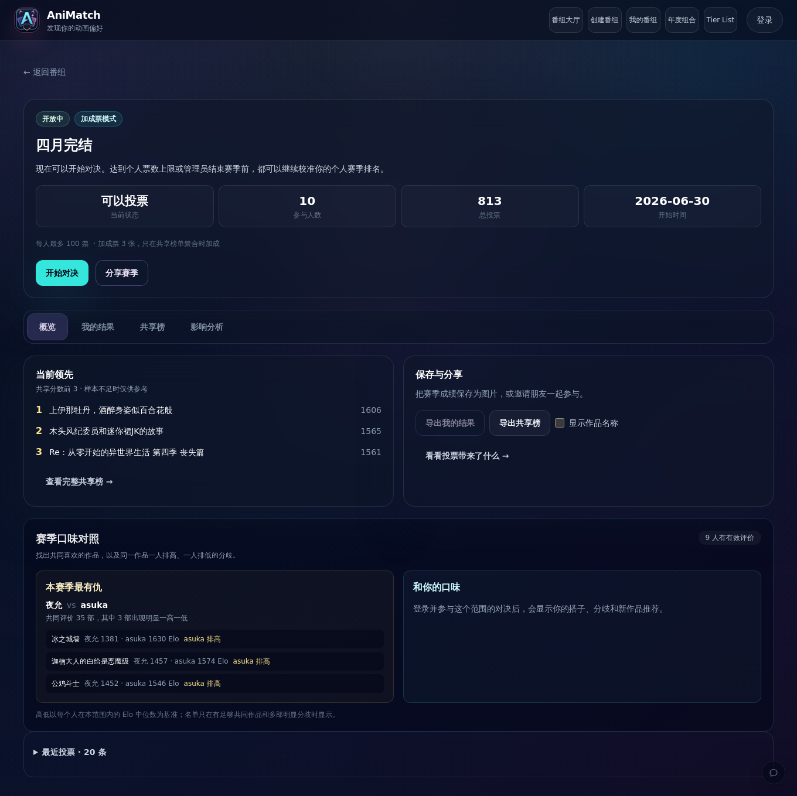

<div align="center">


# AniMatch

**两部动画，你更喜欢哪一部？**
用一次次「左右选择」排出属于你的动画 Tier List，围观社区大乱斗，也能和朋友一起办一届「年度大赏」。

   

</div>

## 这是什么

AniMatch 是一个动画**两两对决（Duel）**工具。

直接给几十部动画手动排 Tier List 很难——你很难说清第 7 名和第 11 名谁更好。AniMatch 换个思路：每次只给你两部作品，回答一个简单问题「更喜欢哪一部」。回答积累起来，模糊的喜好会变成可排序的数据，最后自动生成你的 Tier List。

同一套偏好还能参与公开番组的**社区大乱斗**：每个人按自己的节奏独立排序，系统把大家的结果**匿名聚合**成社区榜单——但不会改写任何人的个人榜单。

## 截图

| 首页 | 对决 | Tier List | 社区榜单 |
| --- | --- | --- | --- |
|  |  |  |  |

## 怎么玩

| 步骤 | 做什么 |
| --- | --- |
| **01 · 添加动画** | 从公开番组挑一个开始，或创建自己的作品池。支持 Bangumi 搜索导入、TierMaker 导入、快速导入、手动添加、图片上传和批量添加。 |
| **02 · 开始对决** | 每次只出现两部作品，只需回答「更喜欢哪一部」。左胜 / 右胜 / 差不多 / 跳过 / 没看过，支持撤回、重开与移动端操作。 |
| **03 · 生成榜单** | 对决积累够多后得到个人 Tier List，可以手动微调最终排序、导出成图片，或生成公开分享链接。 |

> 不想注册？首页的「体验示例番组」用一份内置作品池就能直接玩一轮对决。

## 主要功能

- **普通对决** —— 个人专属的排序过程。每个分数严格属于「你 + 该番组 + 该轮次 + 该作品」，不会串到别人那里。
- **大乱斗赛季** —— 公开番组的社区玩法。每位参与者拥有独立的赛季 Elo 与比较记录；私心票只在社区聚合阶段产生加成。
- **社区榜单 / 社区 Tier List** —— 由匿名聚合结果生成，样本不足的作品单独展示，不混进正式分档。
- **Tier List 导出与分享** —— 可导出为图片（支持可选条目标题），或生成公开分享快照链接。
- **作品管理** —— Bangumi 搜索导入、TierMaker 导入、批量添加、批量编辑标题 / 类型 / 备注、封面修复。
- **年度大赏** —— 面向社区的活动模式：提名 → 入围 → 现场投票 → 揭晓，并支持年度回顾导出。
- **个人主页** —— 每个用户都有 `/u/用户名` 公开页，展示参与过的番组与榜单。

## 计分规则

- 有效结果是左胜 / 右胜 / 平局，会在事务中更新 Elo 和对局流水。
- **跳过不改 Elo**；**没看过**只更新个人状态并从候选中隐藏，不进入个人 Tier List。
- 配对优先考虑未充分比较、Elo 接近、排序边界附近和低置信度的作品，同时避免近期重复组合。
- **手动 Tier 只影响最终展示**，不会篡改 Elo 或对决历史。
- 社区榜单按个人结果聚合，并保留样本门槛，避免单人少量投票直接成为正式排名。

完整原理见 [当前普通对决引擎](docs/ranking-engine-current.md) 与 [对决流水说明](docs/comparison-ledger.md)。

## 本地运行

需要 Node.js 20+、Corepack/pnpm 和 Docker。

```bash
corepack enable
corepack pnpm install
docker compose up -d              # 启动本地 PostgreSQL
cp .env.example .env.local        # 本地配置
corepack pnpm prisma generate
corepack pnpm prisma migrate dev
corepack pnpm dev
```

打开 <http://127.0.0.1:3000>。

常用命令：

```bash
corepack pnpm test                # 单元测试
corepack pnpm lint                # ESLint
corepack pnpm exec tsc --noEmit   # 类型检查
corepack pnpm build               # 生产构建
corepack pnpm db:studio           # Prisma Studio
```

> 本仓库的 `.env` 是指向 `.env.production` 的软链，本地开发请用 `.env.local`，不要覆盖它。

## 技术栈与结构

- **框架**：Next.js 14（App Router）、React 18、TypeScript
- **样式**：Tailwind CSS
- **数据**：Prisma 6 + PostgreSQL，NextAuth / Friend Auth 登录
- **测试**：Vitest
- **部署**：Docker Compose

```
src/app         页面路由与 API 路由（src/app/api）
src/components   UI 组件（对决、Tier List、社区榜单、大赏等）
src/lib          领域逻辑（Elo、配对、计分边界、导入、封面、鉴权等）
prisma/          数据模型与迁移
scripts/         运维与数据脚本
docs/            设计、部署与运维文档
```

API 使用统一响应外层：`{ "ok": true, "data": {} }` / `{ "ok": false, "error": { "message": "..." } }`。
请通过网页界面或 `src/lib/client-api.ts` 访问，不要从浏览器直接请求 Bangumi，也不要把 Elo / 胜负结果作为客户端写入参数。

## 部署

生产部署、备份与恢复见 [部署文档](docs/deploy-server.md)。生产环境只使用 `prisma migrate deploy`，不要执行 `prisma migrate dev`。

## 文档

- [部署与备份](docs/deploy-server.md)
- [好友内测准备](docs/playtest-readiness.md)
- [当前普通对决引擎](docs/ranking-engine-current.md)
- [排名引擎 v2 方向](docs/ranking-engine-v2.md)
- [对决流水说明](docs/comparison-ledger.md)
- [UI 优化路线](docs/animematch-ui-optimization-roadmap.md)

## 许可

本项目基于 [MIT License](LICENSE) 开源。
