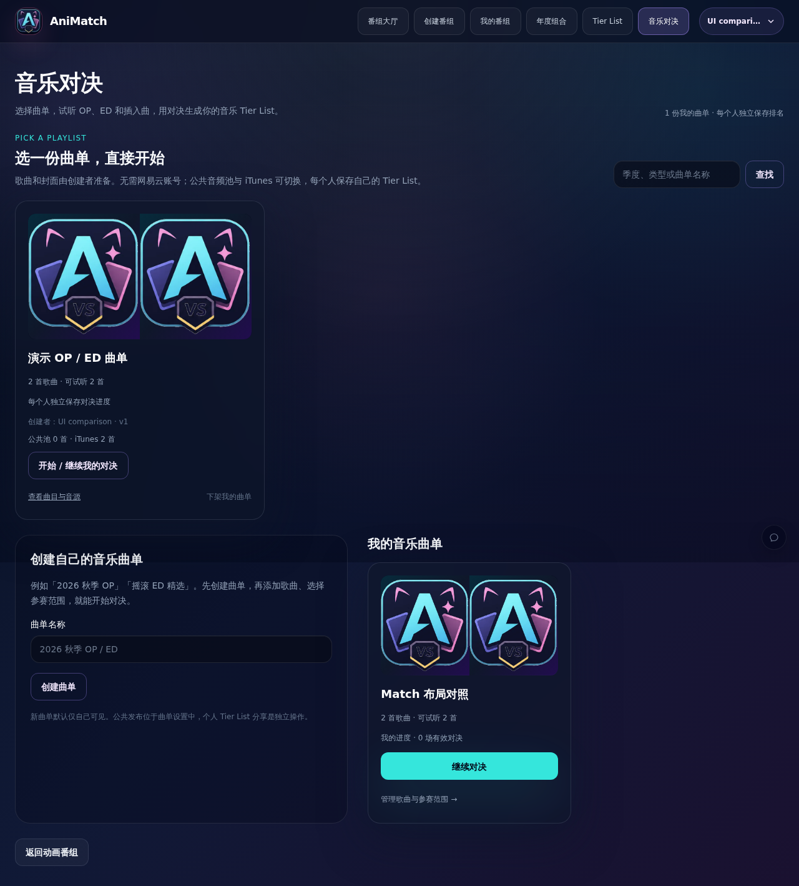
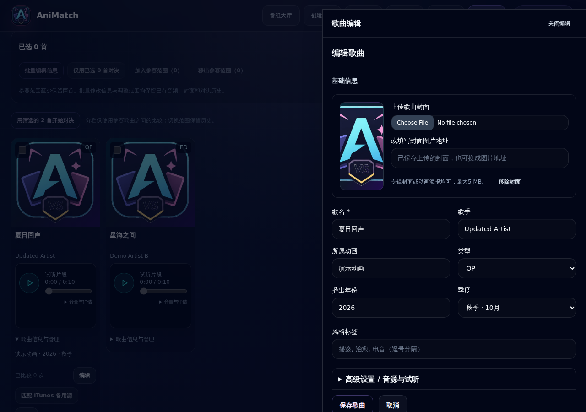
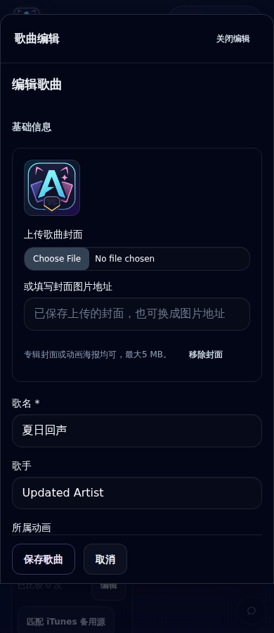
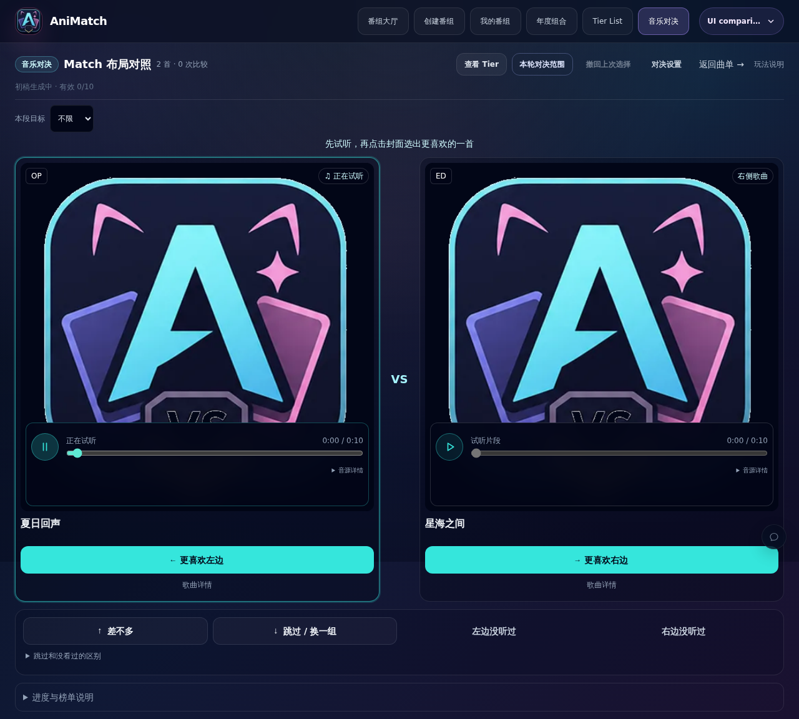
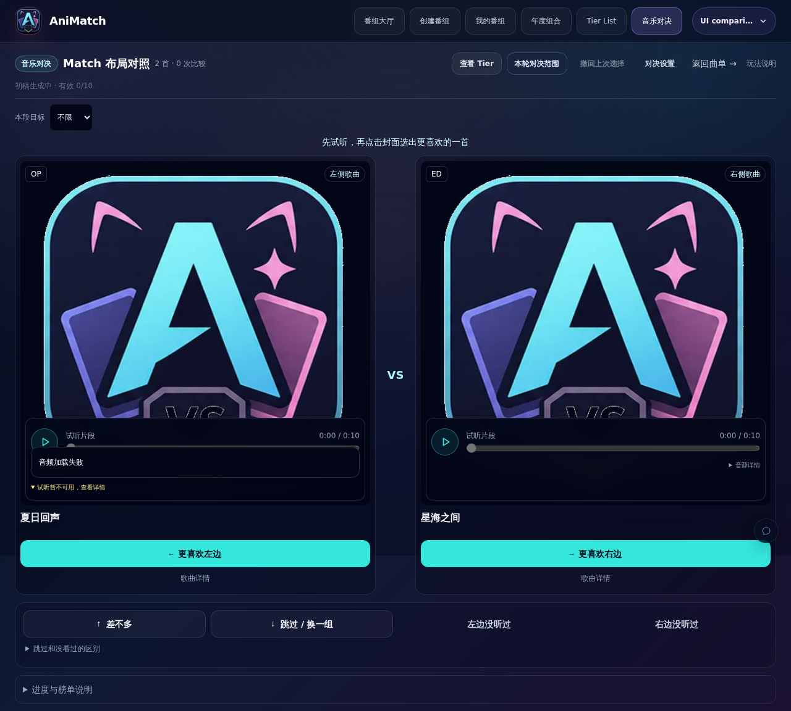
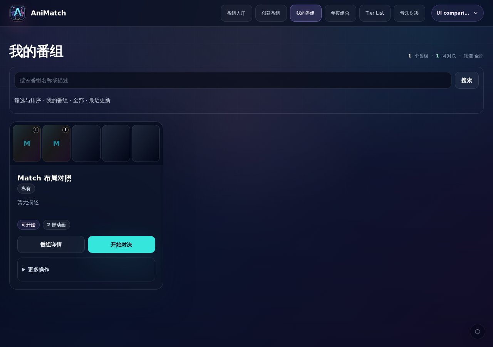

# AniSongMatch 交互一致性修复

分支基于 PR #8 的 `fb5f84c`，需先合入 #8 再将本 PR 调整到 main。仅修改前端及相关测试，没有数据库结构或 API 变更。

## 实现

- 公共与个人曲单共享 SongPlaylistCard，复用 AppCard / AppButton；相同封面比例、标题、歌曲 / 可试听数量、操作及悬停。个人曲单以最多三条并发请求读取已有详情 API，展示实际有效对决数；详情失败时保留导航且不编造数量。
- SongEditDrawer 使用原生 dialog 的焦点限制与恢复，桌面靠右，手机底部且最多 90dvh，内部滚动、锁定背景滚动。移除编辑时 scrollTo，打开已有歌曲不会额外展开背景添加区；单曲与批量编辑共用抽屉。保存、取消操作仍保留原有版本检查与确认。
- SongForm 保留全部文件 / 元数据 / 裁剪逻辑；基础信息优先，音源与试听折叠，底部保存 / 取消固定可达。
- Play / Pause / Loader 使用相同尺寸和描边的 SVG。默认只显示试听、进度、时长、音量与详情入口；技术信息在浮层中。
- 播放器始终保留 24px 状态槽，错误和降级消息在可滚动浮层中完整读取，并通过 live region 通知辅助技术。音量展开也不参与文档流；不截断错误正文。Elo、投票、播放互斥、键盘与 Tier 协议未更改。
- 公共曲单详情与主站使用同一内容宽度。

## 实际验证

使用无网络的独立 PostgreSQL 16 与合成数据，未操作生产数据库。浏览器在 1280 / 768 / 390px 操作编辑、关闭，打开关闭前后 scrollY 不变；保存修改成功。浏览器实际播放测试 WAV，切换另一首后前一首暂停，未触发投票。

同一次测试的 Match 第一张卡片坐标、宽、高（播放前 / 后完全相同）：

| 视口 | x / y | width / height |
|---|---|---|
|1280|24 / 252|584 / 712|
|768|24 / 336|328 / 712|
|390|16 / 426|165 / 510|

在最终构建上重跑 1280 / 390px：编辑保存、关闭、播放和尺寸检查通过；首选 iTunes 不存在时使用本地原音源，实际回退提示不改变尺寸。另用浏览器拦截音频请求模拟网络失败，错误摘要可展开阅读，卡片尺寸不变。这是受控故障测试，不是网易云真实服务验证。没有 pageerror。

测试保留并加强旧的表单渲染约束，加入 SVG 控件和可访问状态区回归断言。全量 159 个文件、1688 个测试通过，退出码 0；Lint、TypeScript 和生产构建通过。一次保存测试使用了不符合编辑 API 规则的手工种子封面路径，修正为合法的测试封面后保存成功，没有为绕过测试修改 API 校验。

未重新完整验收 Tier 拖动、所有音源网络超时组合与真实公共曲单发布；这些逻辑没有变更，相关现有测试已运行。个人统计通过前端详情请求获取，曲单很多时统计会逐步出现；没有新增批量 API。

## 合成数据截图

番组大厅对照（同一合成用户与隔离数据库）：

首页截图含一份合成公共曲单；其 iTunes 编号仅为卡片显示用测试值，没有用它验证真实平台播放。
