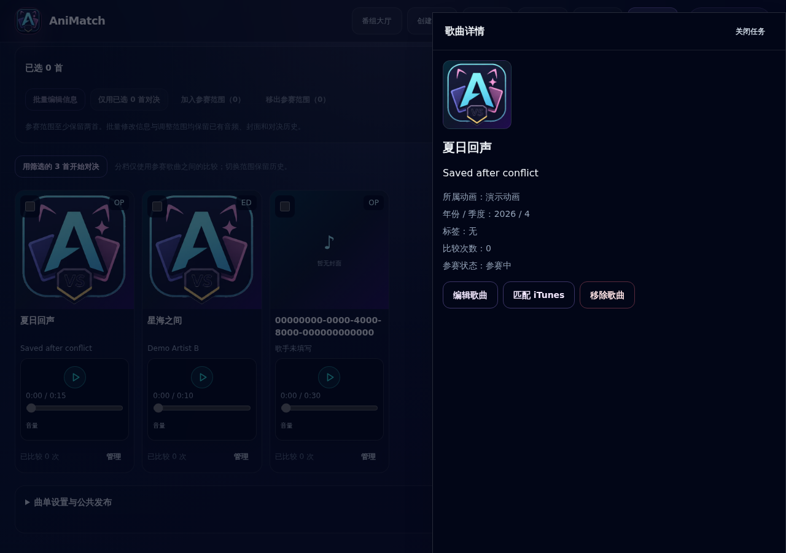
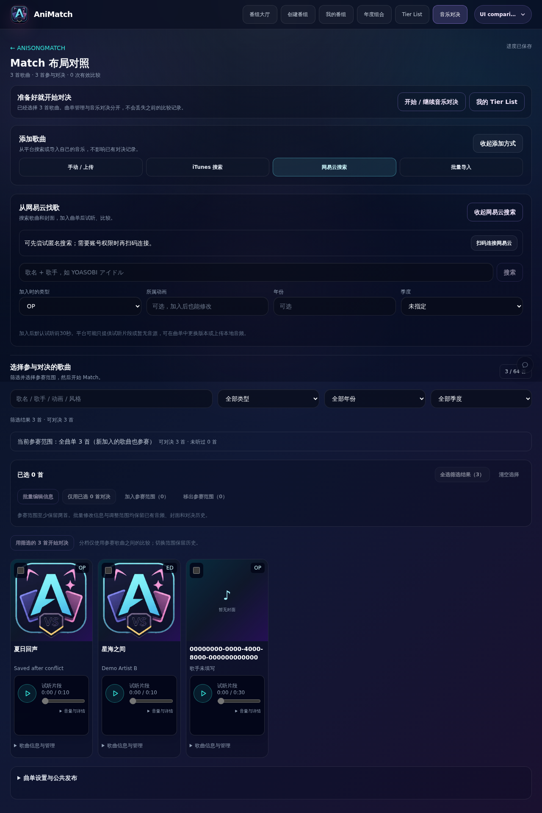
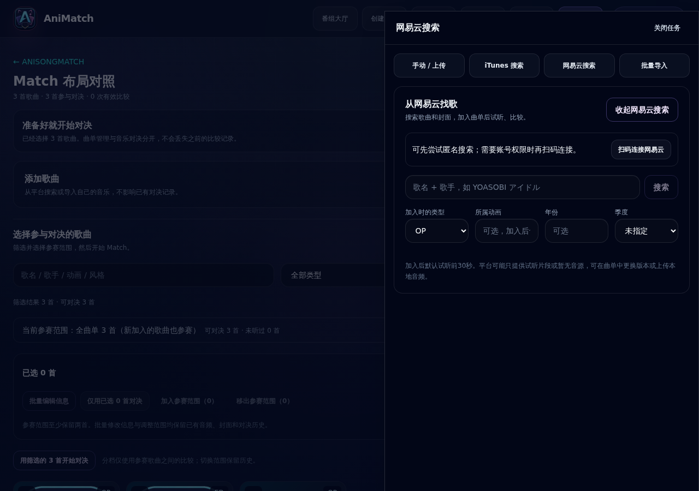
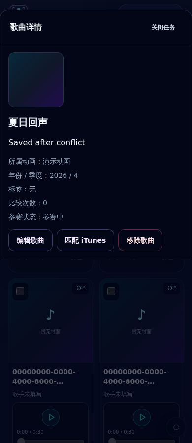
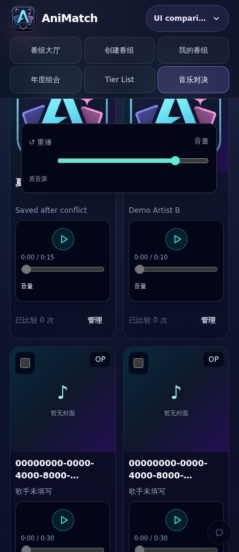
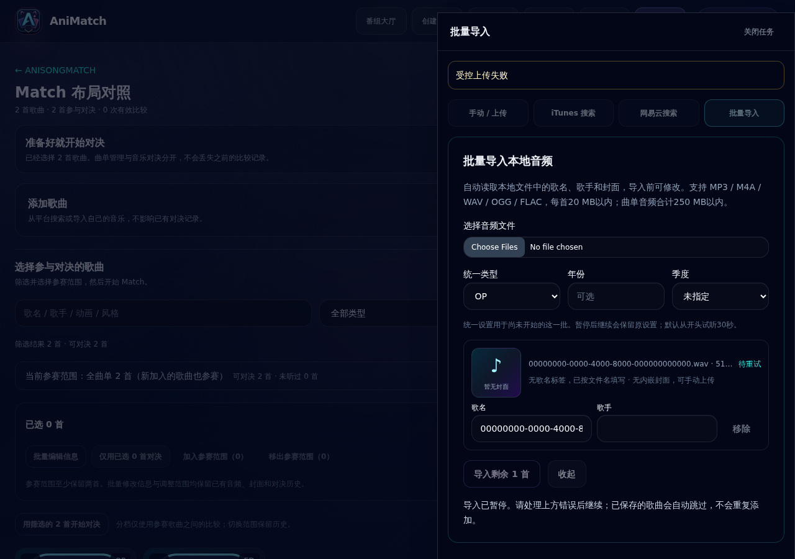

# 稳定歌曲网格与统一任务抽屉

2026-11-01。基于 PR #9 `a741a43` 的独立分支 `codex/anisongmatch-task-drawers`。

## 改动

复用并扩展 SongEditDrawer，统一承载手动添加 / 上传、网易云搜索、iTunes 搜索、批量导入、歌曲详情 / 编辑、iTunes 备用源匹配和批量编辑。主页面只保留添加入口、网格及简短“管理”按钮，已删除卡片内展开管理区及所有 scrollTo。来源切换按钮位于抽屉内部，各任务不再参与主页面布局；同一时刻只有一个任务抽屉。

标题按任务变化；桌面右侧、手机最多 94dvh，内容独立滚动。保留原生 dialog 焦点限制、ESC、背景滚动锁定，并补偿滚动条宽度。未修改直接关闭，修改后确认；拒绝关闭保留输入或队列。输入的 dirty 状态在冒泡阶段记录，避免捕获阶段更新父状态干扰受控输入。移除封面 / 音频和裁剪快捷操作也会标记修改。保存成功后更新卡片；若音源 / 裁剪变化导致旧按钮重建，焦点回到同歌曲的新“管理”按钮，并禁止滚动跳转。

保存错误与冲突重载入口留在抽屉，重新读取版本后仍保留表单草稿。iTunes 匹配保存完成与用户主动收起分别处理，避免成功后再次询问放弃。批量队列完成后清除 dirty 标记，保留暂停、重试及待导入保护。批量编辑背景操作栏保留原尺寸，保存 / 取消位于固定底部区域。

播放器采用真正的卡片容器查询：内容宽度不足 230px 时纵向排列，不依赖屏幕 sm 断点；主要控制和状态行尺寸稳定。音量、重播、技术信息、完整错误与回退说明使用原生 auto popover 顶层，逃离卡片 overflow 裁剪，浏览器负责轻触外部与 ESC 关闭。状态通过 live region 通知，长文本可滚动阅读，不以裁切正文隐藏错误。正常状态不再预留独立空白消息块。

没有修改数据库结构、服务端 API、Elo、投票、Tier 或媒体解析协议。

## 修改前后实测

在独立工作树运行原提交 `a741a43`，使用同一隔离数据库拍摄修改前截图。旧版 1280px 歌曲卡片从约 469px 增至 634px（增加 165px）；打开网易云面板时，页面高度从 1537px 增至 1917px（增加 380px）。新版同类操作对卡片、页面高度及位置的增量均为 0。

全部截图为合成用户、测试封面及测试 WAV，未使用真实用户数据。

| 验收 | 结果 |
|---|---|
| 卡片管理 → 详情 → 编辑 / 匹配 | 通过，无卡片展开，无嵌套抽屉 |
| 网易云 / iTunes / 批量 / 手动任务 | 通过，仅抽屉渲染，背景页面高度不变 |
| 320 / 390 / 768 / 1280 / 1600px | 全部通过，抽屉及页面无水平溢出 |
| 关闭干净任务 | 无确认；焦点与滚动位置保留 |
| 关闭修改后任务并拒绝放弃 | 草稿保留；没有隐藏或卸载任务 |
| 保存后卡片重建 | 实际修改裁剪参数后焦点返回同首歌曲 |
| 版本冲突与重试 | 受控 409，抽屉显示错误，重载后保留草稿，实际保存成功 |
| 搜索结果滚动 | 受控 20 条网易云 / iTunes 结果，背景页面高度与 scrollY 不变 |
| 批量上传失败 / 重试 | 受控首次失败，真实本地 WAV 再次上传成功 |
| 批量暂停 / 续传 | 两文件实际上传，首首完成后暂停；拒绝关闭保留剩余队列；续传完成后关闭无确认 |
| 音量浮层 | 五种宽度均可操作；滑块中心 elementFromPoint 命中滑块，确认未被卡片裁剪 |
| loading / playing / paused | 五种宽度下卡片坐标与尺寸不变；真实 WAV，受控延迟用于覆盖 loading |
| fallback / error | 首选源缺失时实际回退原音源；受控音频请求失败，错误可展开，卡片尺寸不变 |

播放器和批量浏览器测试没有 pageerror。搜索结果和错误响应是受控 UI 测试，不代表真实 iTunes / 网易云服务验收。本轮没有重新验收真实扫码登录、真实平台搜索添加或全部 Tier 导出交互，相关实现未改动且既有回归测试已运行。

全量 159 文件 / 1688 测试通过，退出码 0；最终源码生产 build、TypeScript、Lint 与 diff 检查通过。更新原 UI 结构断言以要求所有任务位于抽屉、禁止卡片内管理区与 scrollTo；没有删除重要断言或关闭检查。

## 前后截图

旧版卡片展开：

新版详情：

旧版搜索撑开主页面：

新版独立搜索任务：

手机任务与未被裁剪的播放器浮层：

批量失败重试：

## 合并与部署

本 PR 堆叠在 PR #9 上；#9 合并后调整本 PR 目标为 main 并检查最终 diff。没有推送 main、合并或部署生产。原生 popover 依赖支持 Popover API 的浏览器；本轮使用当前 Chromium 实测。
