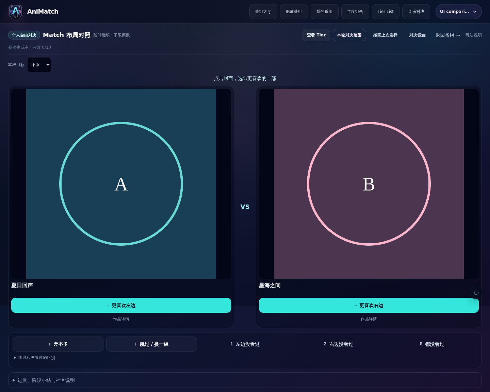
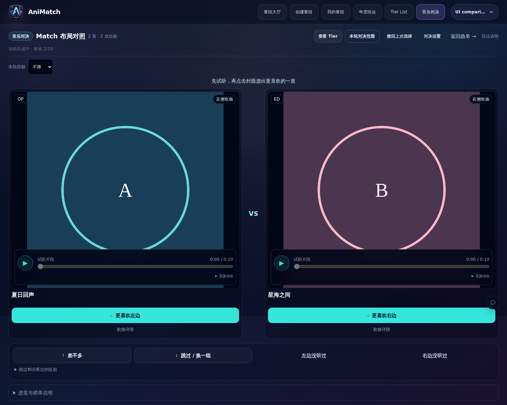
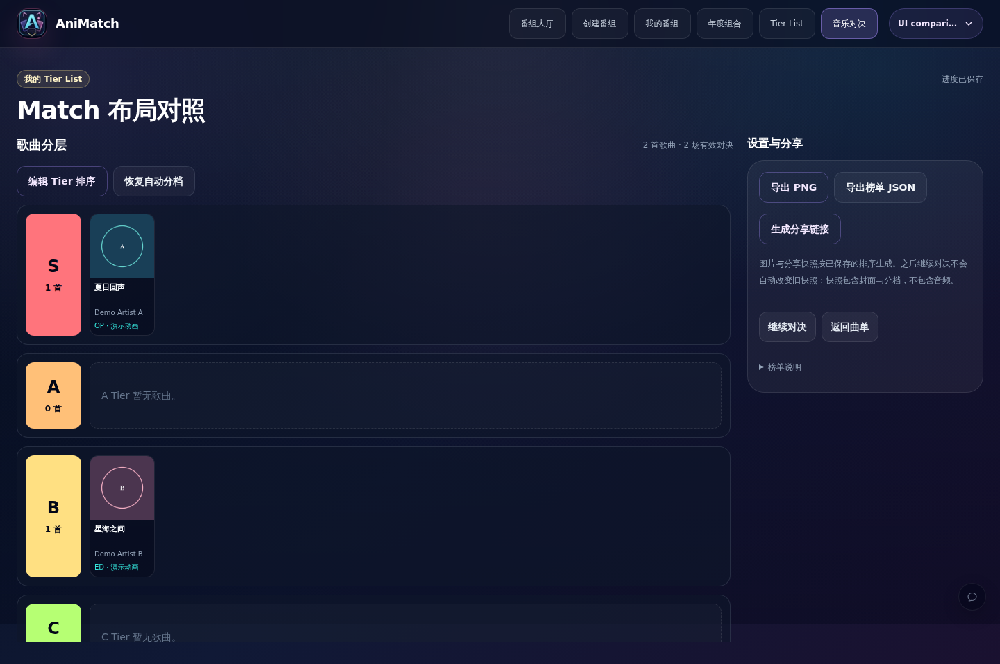
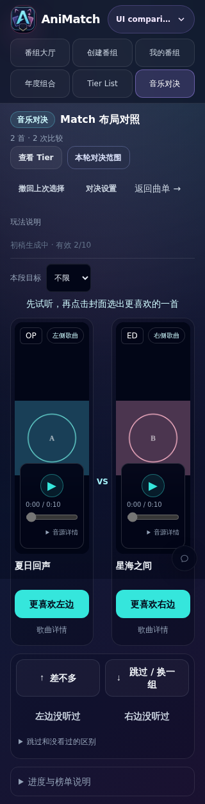

# 音乐页面与普通 Match 的视觉对齐

本次基于 main `3a2f07a` 修复。先前只共享卡片外壳，音乐页仍使用不同的封面高度、常驻设置、完整播放器、进度面板与榜单密度，不能算作整页一致。

## 修改

- 音乐 Match 使用普通 Match 的页面内边距、卡片高度、标题、主投票按钮和详情入口；试听设置移到顶部“对决设置”，进度移到下方可展开区域。
- 复用本段目标控件；提示行位于相同位置。试听、暂停、进度和音源详情放在封面底部独立层中，均位于投票按钮之外，保持 Q/E 互斥播放。
- 修复 SongCover 的尺寸上限覆盖容器上限，避免裁切 / 非等比显示；低清图仍限制放大。
- 音乐 Tier 使用普通 Tier 的分栏、档位行、档位计数、紧凑小卡片、滚动榜单和右侧导出 / 分享工具；保留排序、撤销、恢复、分享快照与 PNG / JSON。
- 音乐首页及曲单页采用同一页面宽度，首页去掉大幅宣传块，曲单改为封面卡片墙，播放器保持可见，管理操作可展开。
- 普通 Match 的默认渲染不变；没有修改数据库、迁移、投票协议、Elo 或音源解析。

## 浏览器验证

使用完全独立的 PostgreSQL 16、合成用户、两张自行生成的相同封面和两段测试 WAV，对照普通动画与音乐 Match。无生产数据或用户截图。

视口高度 900px。实测第一张卡片（普通 / 音乐）：

| 宽度 | 卡片宽度 | 卡片高度 | 封面高度 | 横向溢出 |
|---|---|---|---|---|
| 1440 | 664 / 664 | 712 / 712 | 558 / 558 | 无 |
| 768 | 328 / 328 | 712 / 712 | 558 / 558 | 无 |
| 390 | 165 / 165 | 510 / 510 | 360 / 360 | 无 |
| 320 | 130 / 130 | 510 / 510 | 360 / 360 | 无 |

前三个宽度的卡片起点一致；320px 时因工具栏文字换行，起点相差 8px。音乐保留左右“没听过”两个入口，不添加普通动画的“都没看过”批量协议。

- 播放 A 后等待真实播放时间推进，再播放 B：A 暂停，B 时间推进；暂停后两个 audio 均 paused。
- 试听操作没有产生投票；点击主投票按钮后记录新增，刷新保留。
- Tier 四种宽度均无横向溢出。修改档位、保存刷新、撤销草稿、恢复自动通过，恢复后投票条数不变。
- 浏览器实际收到 JSON、PNG 下载；生成首页和曲单卡片墙截图；无 pageerror。

## 截图

全部为合成数据。图形封面用于比较相同比例，不代表真实音乐或动画。

普通 Match：

音乐 Match：

音乐 Tier：

手机：

## 最终检查

2026-11-01：最终源码全量测试 159 个文件 / 1687 个测试通过，进程退出码 0；lint、`tsc --noEmit`、生产 build、`git diff --check` 通过。没有删除或弱化既有测试。本次只提交 UI 与验证截图，生产部署独立进行。
