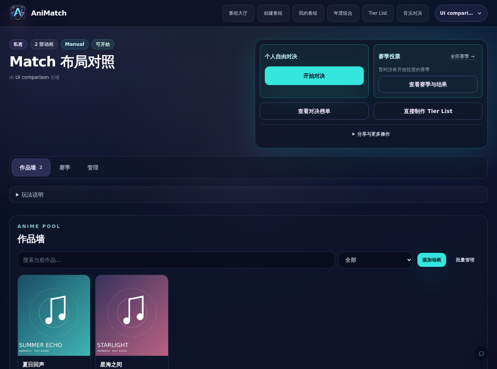
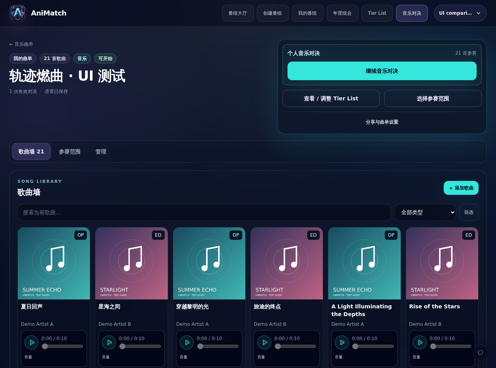
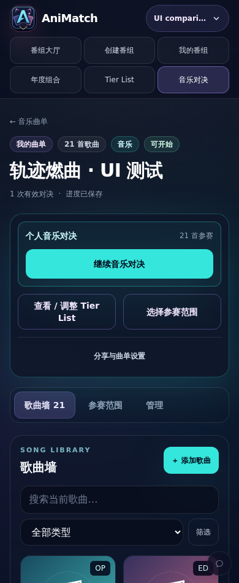
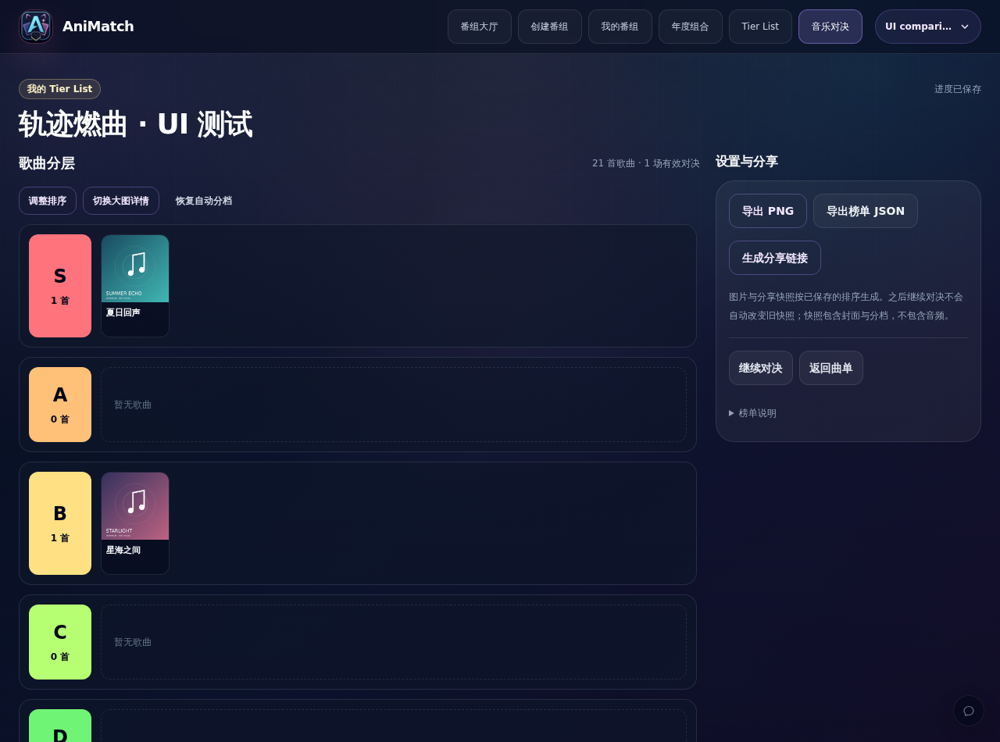
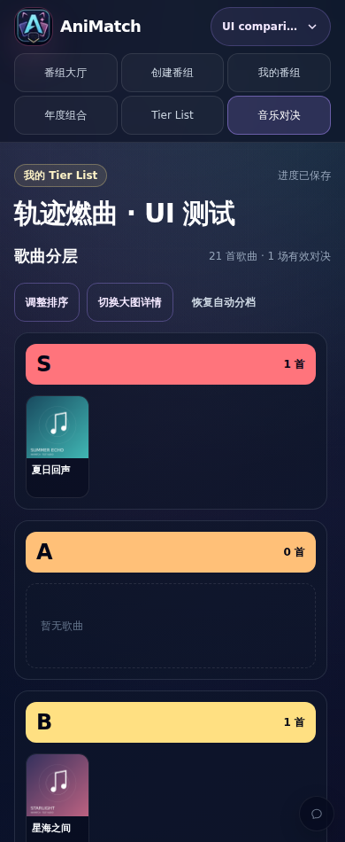

# 音乐曲单与番组工作区一致性

2026-11-01。基于已部署的 PR #10（b7f4b94），独立分支 codex/anisongmatch-workspace-parity。本轮没有修改数据库、API、Elo、投票或分享快照格式，也没有部署生产。

## 问题与调整

音乐曲单页把对决、添加、筛选、参赛统计、批量操作与设置堆在同一个纵向页面；对决按钮遗漏 primary，实际采用 AppButton 默认 secondary 样式。现复用 AppCard / AppBadge / AppButton，与番组页一致地采用左侧信息、右侧行动卡、下方页签和歌曲墙。音乐不支持赛季，因此不添加无功能赛季入口。

主按钮为青色开始 / 继续音乐对决。查看 / 调整 Tier List、选择参赛范围是次级入口；分享与曲单设置放在管理页签。默认歌曲墙只保留搜索、类型、折叠的年份 / 季度筛选、添加按钮及歌曲。参赛复选框、批量编辑与范围操作只在参赛范围页签展示。已有任务抽屉继续承载添加、搜索、编辑、音源匹配和批量编辑。页签可通过键盘切换焦点；未保存名称离开管理页签需确认。

音乐 Tier 原先已具有编辑模式，但入口不直观，进入后会切换成大卡片，每张卡片再增加选择器和排序按钮。现查看与编辑共用 SongTierView，保留相同紧凑卡片尺寸，使用与番组一致的“调整排序”“切换大图详情”。支持桌面拖动跨档、档内排序，以及手机点选歌曲后选择档位 / 前移 / 后移。草稿明确保存，保留撤销、失败重试、离开保护，并新增取消编辑时的放弃确认。分享、导出不包含未保存草稿。

窄卡片的播放器在容器宽度足够（140px）时使用紧凑横排，极窄时仍纵排；Match 播放器原有宽度条件不变。

## 验证

使用本机隔离 PostgreSQL（anisong-dev-db，55439）及本地开发服务（3013），仅创建合成用户、曲单、封面、WAV 和投票记录。没有使用生产凭据模拟登录，没有修改真实用户曲单。浏览器截图均为合成数据。

- 320 / 390 / 768 / 1280 / 1600px，21 首合成歌曲：歌曲墙和 Tier 无横向溢出。
- 浏览器计算样式验证主按钮背景为 rgb(53, 230, 220)。默认歌曲墙不展示参赛管理面板；范围入口正常切换。
- 打开 / 关闭详情抽屉，背景卡片位置与尺寸保持一致。
- 五种宽度进入 / 退出 Tier 排序，歌曲卡片宽高完全一致。
- 实际拖动跨档、撤销、点选分档、拒绝放弃草稿、保存后刷新、恢复自动分档通过。
- 五种宽度批量编辑抽屉不撑高列表，真实 WAV 加载 / 播放 / 暂停无卡片尺寸变化。
- 受控音源回退 / 请求失败：错误仍可展开阅读，卡片尺寸不变。受控故障不代表真实网易云或 iTunes 服务验收。
- 使用最终生产构建在隔离环境补测：档内拖动排序、保存 / 刷新、投票历史保持原样、生成公开分享快照并打开只读分享页均通过。共用 Tier 组件明确保留客户端边界，避免分享页的事件处理器跨服务端边界。
- 浏览器无 pageerror。
- 160 个测试文件 / 1692 个测试通过；TypeScript、Lint、生产构建、git diff --check 通过。
- 新增纯函数测试覆盖跨档、档内双向排序、待比较歌曲手动分档、隐藏 / 排除歌曲保护和布局不被原地修改。结构断言迁移到实际承载拖动的共用视图，没有删除原有行为要求。

本轮不重新验收真实平台搜索、扫码登录、PNG 导出或旧分享链接，相关协议没有变化。手机端采用点选及明确控件，不宣称移动浏览器原生 HTML 拖动已通过。

## 截图

合成番组对照：

音乐曲单：

Tier List：

本 PR 堆叠于 codex/anisongmatch-task-drawers（PR #10）。应按依赖顺序合并并重新检查最终差异；没有合并任何 PR 或推送 main。
